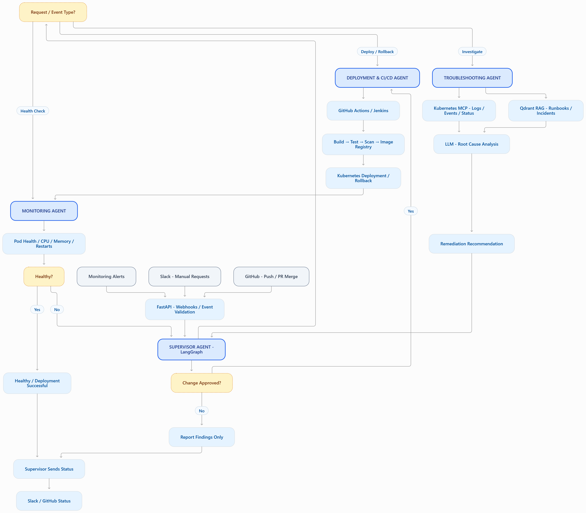
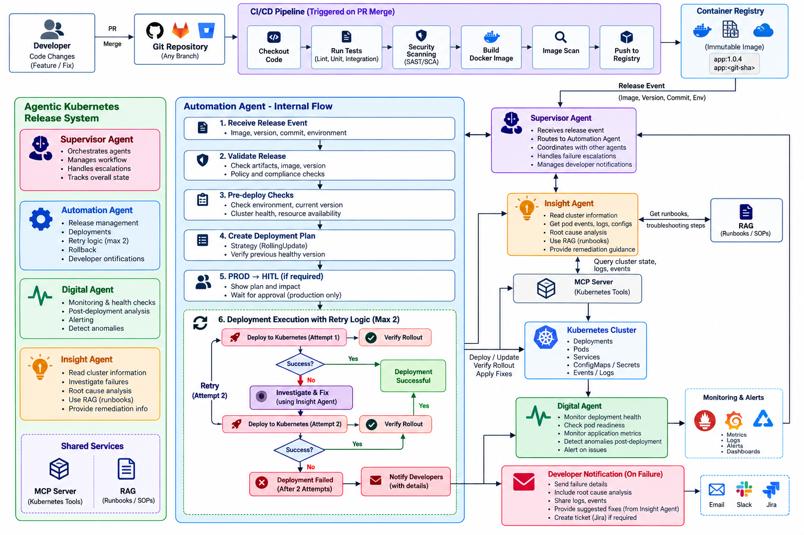
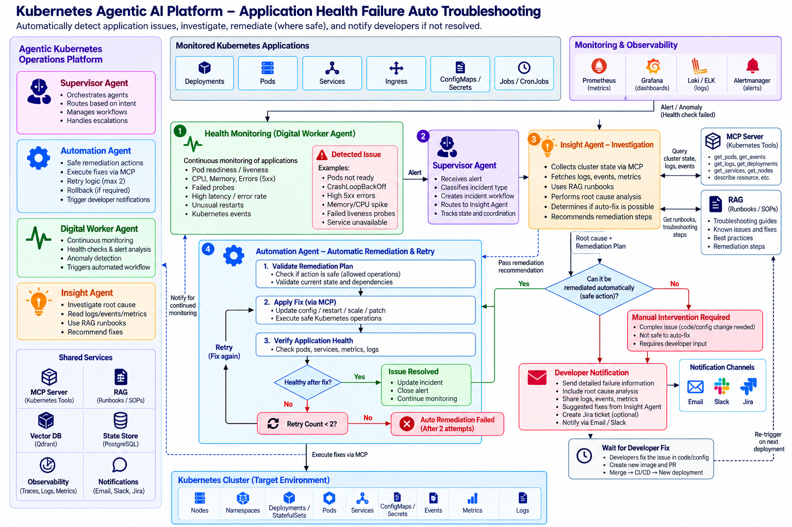

## Flow

## Project

In our **KubePilot AI project**, we divided responsibilities across four specialized agents: **Supervisor, Deployment & CI/CD, Monitoring, and Troubleshooting**.

The **Supervisor Agent** is responsible for orchestration. It receives requests from Slack, GitHub webhook events, and monitoring alerts, then routes them to the appropriate agent using LangGraph.

The **Deployment & CI/CD Agent** handles application delivery. It coordinates with GitHub Actions or Jenkins for building, testing, and scanning container images, and manages Kubernetes deployments and rollbacks through authorized tools.

The **Monitoring Agent** continuously checks Kubernetes application health, including pod readiness, restarts, CPU and memory usage, and deployment availability. When it detects abnormal behavior, it reports the incident to the Supervisor.

The **Troubleshooting Agent** investigates failures. It collects Kubernetes logs, events, and pod status using MCP tools and retrieves relevant troubleshooting runbooks from Qdrant using RAG. The LLM analyzes this evidence to identify possible root causes and recommend remediation.

If a change is required, the Supervisor obtains the necessary approval and delegates execution to the Deployment Agent. After execution, the Monitoring Agent verifies recovery.

Finally, the Supervisor communicates the results through Slack or GitHub.

**We intentionally separated orchestration, deployment, monitoring, and troubleshooting so that each agent has a clear responsibility, and sensitive infrastructure changes remain controlled and auditable.**

## Understand each agent individually

### Agent 1 — Supervisor Agent

This is the coordinator of the platform. It receives validated events from Slack, GitHub, or monitoring alerts, identifies the task, and decides which specialized agent should handle it.

For example, a deployment request goes to the Deployment Agent, while a pod failure goes to the Troubleshooting Agent.

It also maintains workflow state, requests human approval when required, and sends the final result back to Slack or GitHub.

### Agent 2 — Deployment & CI/CD Agent

This agent owns the complete application delivery lifecycle.

It coordinates with GitHub Actions or Jenkins to trigger pipelines, checks build/test/security-scan results, validates deployment parameters, and invokes authorized Kubernetes tools to perform deployment or rollback.

It also checks the immediate rollout result. The Monitoring Agent handles ongoing health monitoring.

Important: The agent does not need to build Docker images itself. It orchestrates the existing CI/CD tools.

### Agent 3 — Monitoring Agent

This agent owns Kubernetes operational health.

It consumes metrics and alerts from monitoring tools and checks pod readiness, restart counts, CPU/memory usage, deployment availability, and abnormal behavior.

When it detects an issue, it creates a structured incident with details such as cluster, namespace, deployment, severity, and observed symptoms.

It reports the incident to the Supervisor. It does not diagnose the complete root cause or change Kubernetes resources.

### Agent 4 — Troubleshooting Agent

This agent owns investigation and root-cause analysis.

It retrieves Kubernetes pod status, events, logs, and relevant metrics through read-only MCP tools. It searches Qdrant for troubleshooting runbooks and historical incidents, then uses the LLM to correlate evidence and recommend a fix.

It returns the diagnosis, supporting evidence, confidence or uncertainty, and proposed remediation to the Supervisor.

It does not execute the fix. Execution goes to the Deployment Agent after authorization and any required approval.

## Kubernetes Deployment 

## Kubernetes TroubleShooting 
