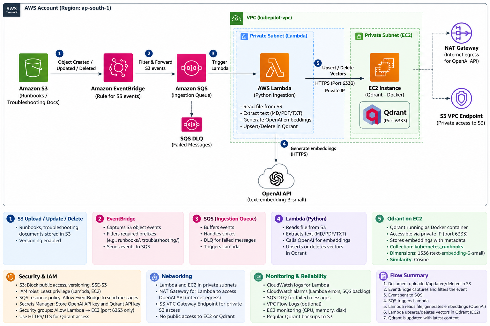

# How did you design and automate the RAG knowledge-base ingestion pipeline in your KubePilot AI platform?

**Architecture:** S3 → EventBridge → SQS → Lambda → Qdrant on EC2 (Parent-Child Chunking)

In our **KubePilot AI platform**, we designed an **event-driven RAG ingestion architecture** to automatically synchronize Kubernetes runbooks and troubleshooting documents from Amazon S3 into Qdrant, which serves as our vector database.

**Amazon S3 acts as the source of truth** for all runbooks and troubleshooting documents. We enabled S3 versioning to track document updates.

Whenever a document is uploaded, modified, or deleted, S3 publishes an event to Amazon EventBridge. EventBridge filters events based on the configured S3 bucket and document prefixes, such as `runbooks/` and `troubleshooting/`, and forwards matching events to Amazon SQS.

We introduced **SQS to decouple event generation from document processing**. This is important because if hundreds of runbooks are uploaded simultaneously, we don't want to overwhelm our embedding API or Qdrant. SQS buffers events, supports retries, and uses a dead-letter queue for messages that repeatedly fail.

AWS Lambda acts as our Python-based ingestion worker. Lambda consumes messages from SQS, identifies the changed S3 object, and downloads the document.

For new or modified documents, Lambda extracts text from Markdown, PDF, or text files. Instead of using traditional recursive chunking, **we use a parent-child chunking strategy to improve retrieval accuracy while preserving document context**.

In this approach, we first divide each document into larger, meaningful parent sections based on headings, subheadings, and logical content boundaries. Each parent section is then divided into smaller child chunks.

For example, we use **parent chunks of approximately 1,500–2,000 tokens and child chunks of approximately 300–500 tokens**, depending on the document structure.

We generate embeddings only for the smaller child chunks using OpenAI's `text-embedding-3-small` model, which produces 1536-dimensional vectors.

These child embeddings are stored in the `kubernetes_runbooks` collection in Qdrant, configured with cosine similarity. Each child vector contains metadata such as document ID, parent ID, child ID, S3 source path, version ID, and section heading.

The larger parent sections are stored separately in an S3-backed parent-document store and referenced through their parent IDs.

**During retrieval, the Insight Agent performs similarity search against the child embeddings in Qdrant. Instead of passing only the matched child chunks to the LLM, we use the parent IDs to retrieve the corresponding larger parent sections.**

This allows us to combine the **retrieval precision of smaller chunks with the richer context of larger document sections**, which is particularly useful for Kubernetes troubleshooting runbooks where symptoms, root causes, and remediation steps may span multiple paragraphs.

Qdrant runs on an AWS EC2 instance inside a private VPC subnet. Lambda is also attached to private subnets and connects to Qdrant through the private network. For secure communication, we use security groups and TLS. Lambda accesses the external OpenAI API through a NAT Gateway.

For document updates, we use version-aware processing to replace outdated child embeddings and their associated parent sections. For deletions, we remove the corresponding child vectors and parent-document references.

From a reliability perspective, we use SQS retries, a dead-letter queue, CloudWatch monitoring, and idempotent processing to handle duplicate events.

Finally, our **KubePilot Insight Agent** uses this parent-child RAG retrieval approach to provide more complete and contextually accurate Kubernetes troubleshooting recommendations.

This architecture provides **automatic knowledge-base synchronization, context-aware retrieval, improved answer grounding, scalability, fault tolerance, and secure access to the vector database**.


# Ingestion Flow Diagram




# Code Chnages

```py

import os
import re
import json
import uuid
import hashlib
from io import BytesIO

import boto3
import tiktoken
from botocore.exceptions import ClientError
from openai import OpenAI
from pypdf import PdfReader
from qdrant_client import QdrantClient, models


# ============================================================
# AWS CLIENTS AND CONFIGURATION
# ============================================================

s3 = boto3.client("s3")
secrets = boto3.client("secretsmanager")

BUCKET = os.environ["S3_BUCKET"]
COLLECTION = os.environ.get(
    "QDRANT_COLLECTION",
    "kubernetes_runbooks"
)

PARENT_PREFIX = "rag-parents"

EMBEDDING_MODEL = "text-embedding-3-small"

# Parent and child chunk sizes are measured in TOKENS.
PARENT_TARGET_TOKENS = 1800
PARENT_MAX_TOKENS = 2000

CHILD_SIZE = 400
CHILD_OVERLAP = 50

# text-embedding-3-small uses cl100k_base.
tokenizer = tiktoken.get_encoding("cl100k_base")


def read_secret(secret_id):
    response = secrets.get_secret_value(
        SecretId=secret_id
    )
    return response["SecretString"]


openai_client = OpenAI(
    api_key=read_secret(os.environ["OPENAI_SECRET_ID"])
)

qdrant = QdrantClient(
    url=os.environ["QDRANT_URL"],
    api_key=read_secret(os.environ["QDRANT_SECRET_ID"]),
    timeout=30
)


# ============================================================
# TOKEN HELPERS
# ============================================================

def count_tokens(text):
    return len(tokenizer.encode(text))


def split_by_tokens(text, size, overlap=0):
    """
    Split text into token-based chunks.

    This is not RecursiveCharacterTextSplitter.
    """
    tokens = tokenizer.encode(text)

    if not tokens:
        return []

    if overlap >= size:
        raise ValueError(
            "Overlap must be smaller than chunk size"
        )

    chunks = []
    step = size - overlap

    for start in range(0, len(tokens), step):
        end = min(start + size, len(tokens))

        chunk = tokenizer.decode(
            tokens[start:end]
        ).strip()

        if chunk:
            chunks.append(chunk)

        if end == len(tokens):
            break

    return chunks


# ============================================================
# DOCUMENT EXTRACTION
# ============================================================

def extract_text(content, key):
    filename = key.lower()

    if filename.endswith((".md", ".txt")):
        return content.decode("utf-8")

    if filename.endswith(".pdf"):
        reader = PdfReader(BytesIO(content))

        return "\n\n".join(
            page.extract_text() or ""
            for page in reader.pages
        )

    return None


# ============================================================
# STRUCTURE-AWARE PARENT CHUNKING
# ============================================================

def split_into_sections(text):
    """
    Prefer Markdown headings as logical boundaries.

    For PDFs and TXT files without headings,
    the document becomes one initial section.
    """
    sections = []
    current_lines = []

    for line in text.splitlines():
        is_heading = bool(
            re.match(r"^\s{0,3}#{1,6}\s+", line)
        )

        if is_heading and current_lines:
            section = "\n".join(
                current_lines
            ).strip()

            if section:
                sections.append(section)

            current_lines = []

        current_lines.append(line)

    if current_lines:
        section = "\n".join(
            current_lines
        ).strip()

        if section:
            sections.append(section)

    return sections


def create_parent_chunks(text):
    """
    Create structure-aware parent chunks.

    1. Prefer document section boundaries.
    2. Combine smaller sections up to target size.
    3. Split oversized sections by token count.
    """
    sections = split_into_sections(text)

    parents = []
    current_parent = ""
    current_tokens = 0

    for section in sections:
        section_tokens = count_tokens(section)

        # Split oversized sections into multiple parents.
        if section_tokens > PARENT_MAX_TOKENS:
            if current_parent:
                parents.append(current_parent.strip())
                current_parent = ""
                current_tokens = 0

            large_section_parts = split_by_tokens(
                section,
                size=PARENT_TARGET_TOKENS,
                overlap=0
            )

            parents.extend(large_section_parts)
            continue

        # Add section to current parent when it fits.
        if (
            current_tokens + section_tokens
            <= PARENT_TARGET_TOKENS
        ):
            current_parent = (
                current_parent + "\n\n" + section
            ).strip()

            current_tokens = count_tokens(
                current_parent
            )

        else:
            if current_parent:
                parents.append(current_parent.strip())

            current_parent = section
            current_tokens = section_tokens

    if current_parent:
        parents.append(current_parent.strip())

    return parents


# ============================================================
# CHILD CHUNKING
# ============================================================

def create_child_chunks(parent_text):
    """
    Child chunks are approximately 400 tokens,
    with 50-token overlap.
    """
    return split_by_tokens(
        parent_text,
        size=CHILD_SIZE,
        overlap=CHILD_OVERLAP
    )


# ============================================================
# DOCUMENT IDENTIFIERS
# ============================================================

def make_parent_id(document_id, version_id, index):
    return str(
        uuid.uuid5(
            uuid.NAMESPACE_URL,
            f"{document_id}:{version_id}:parent:{index}"
        )
    )


def make_child_id(parent_id, child_index):
    return str(
        uuid.uuid5(
            uuid.NAMESPACE_URL,
            f"{parent_id}:child:{child_index}"
        )
    )


def make_document_hash(text):
    return hashlib.sha256(
        text.encode("utf-8")
    ).hexdigest()


# ============================================================
# PARENT STORAGE IN S3
# ============================================================

def parent_s3_key(document_id, version_id, parent_id):
    """
    Hash the source key to avoid collisions
    and unsafe characters in parent object paths.
    """
    doc_hash = hashlib.sha256(
        document_id.encode("utf-8")
    ).hexdigest()

    return (
        f"{PARENT_PREFIX}/"
        f"{doc_hash}/"
        f"{version_id}/"
        f"{parent_id}.json"
    )


def store_parent(
    document_id,
    version_id,
    parent_id,
    parent_index,
    parent_text
):
    key = parent_s3_key(
        document_id,
        version_id,
        parent_id
    )

    payload = {
        "document_id": document_id,
        "version_id": version_id,
        "parent_id": parent_id,
        "parent_index": parent_index,
        "text": parent_text,
        "token_count": count_tokens(parent_text)
    }

    s3.put_object(
        Bucket=BUCKET,
        Key=key,
        Body=json.dumps(payload).encode("utf-8"),
        ContentType="application/json",
        ServerSideEncryption="AES256"
    )

    return key


def get_parent(parent_s3_path):
    """
    Used by the Insight Agent during retrieval.
    """
    response = s3.get_object(
        Bucket=BUCKET,
        Key=parent_s3_path
    )

    return json.loads(
        response["Body"].read()
    )


# ============================================================
# QDRANT FILTERS
# ============================================================

def document_filter(document_id):
    return models.Filter(
        must=[
            models.FieldCondition(
                key="document_id",
                match=models.MatchValue(
                    value=document_id
                )
            )
        ]
    )


def delete_document_vectors(document_id):
    qdrant.delete(
        collection_name=COLLECTION,
        points_selector=models.FilterSelector(
            filter=document_filter(document_id)
        ),
        wait=True
    )


# ============================================================
# PARENT-CHILD INDEXING
# ============================================================

def index_document(document_id, version_id, text):
    """
    Parent-child indexing:

    Document
       -> Parent chunks
       -> Child chunks
       -> Child embeddings
       -> Qdrant

    Parent content is stored separately in S3.
    """
    parents = create_parent_chunks(text)

    if not parents:
        raise ValueError("No parent chunks created")

    all_points = []

    for parent_index, parent_text in enumerate(parents):

        parent_id = make_parent_id(
            document_id,
            version_id,
            parent_index
        )

        # Store the complete parent section in S3.
        parent_key = store_parent(
            document_id=document_id,
            version_id=version_id,
            parent_id=parent_id,
            parent_index=parent_index,
            parent_text=parent_text
        )

        children = create_child_chunks(parent_text)

        if not children:
            continue

        # Generate embeddings only for child chunks.
        embedding_response = (
            openai_client.embeddings.create(
                model=EMBEDDING_MODEL,
                input=children
            )
        )

        for child_index, embedding in enumerate(
            embedding_response.data
        ):

            child_id = make_child_id(
                parent_id,
                child_index
            )

            point = models.PointStruct(
                id=child_id,
                vector=embedding.embedding,
                payload={
                    "document_id": document_id,
                    "version_id": version_id,
                    "parent_id": parent_id,
                    "child_id": child_id,
                    "parent_index": parent_index,
                    "child_index": child_index,
                    "text": children[child_index],
                    "parent_s3_key": parent_key,
                    "source": (
                        f"s3://{BUCKET}/{document_id}"
                    ),
                    "chunking_strategy": "parent-child"
                }
            )

            all_points.append(point)

    if not all_points:
        raise ValueError("No child vectors generated")

    # Batch Qdrant writes instead of one large request.
    BATCH_SIZE = 100

    for start in range(0, len(all_points), BATCH_SIZE):
        batch = all_points[start:start + BATCH_SIZE]

        qdrant.upsert(
            collection_name=COLLECTION,
            points=batch,
            wait=True
        )

    # Remove child vectors from older versions.
    qdrant.delete(
        collection_name=COLLECTION,
        points_selector=models.FilterSelector(
            filter=models.Filter(
                must=[
                    models.FieldCondition(
                        key="document_id",
                        match=models.MatchValue(
                            value=document_id
                        )
                    )
                ],
                must_not=[
                    models.FieldCondition(
                        key="version_id",
                        match=models.MatchValue(
                            value=version_id
                        )
                    )
                ]
            )
        ),
        wait=True
    )

    print(
        f"Indexed {document_id}: "
        f"{len(parents)} parents, "
        f"{len(all_points)} children"
    )


# ============================================================
# S3 DOCUMENT SYNCHRONIZATION
# ============================================================

def sync_document(key):
    if not key.startswith(
        ("runbooks/", "troubleshooting/")
    ):
        return

    if not key.lower().endswith(
        (".md", ".txt", ".pdf")
    ):
        return

    try:
        metadata = s3.head_object(
            Bucket=BUCKET,
            Key=key
        )

    except ClientError as exc:
        code = exc.response["Error"]["Code"]

        if code in ("404", "NoSuchKey", "NotFound"):
            delete_document_vectors(key)
            print(f"Deleted vectors for {key}")
            return

        raise

    version_id = metadata["VersionId"]

    response = s3.get_object(
        Bucket=BUCKET,
        Key=key,
        VersionId=version_id
    )

    content = response["Body"].read()

    text = extract_text(content, key)

    if not text or not text.strip():
        raise ValueError(
            f"Empty or unreadable document: {key}"
        )

    index_document(
        document_id=key,
        version_id=version_id,
        text=text
    )


# ============================================================
# LAMBDA HANDLER
# ============================================================

def lambda_handler(event, context):
    failures = []

    for record in event.get("Records", []):
        try:
            message = json.loads(record["body"])

            if message.get("source") != "aws.s3":
                continue

            detail = message["detail"]

            if detail["bucket"]["name"] != BUCKET:
                raise ValueError("Unexpected S3 bucket")

            # EventBridge S3 object keys are normally
            # supplied directly, unlike classic S3
            # event notification key encoding.
            key = detail["object"]["key"]

            sync_document(key)

            print(
                f"Parent-child synchronization "
                f"completed: {key}"
            )

        except Exception as exc:
            print(
                f"Failed message "
                f"{record['messageId']}: {exc}"
            )

            failures.append({
                "itemIdentifier": record["messageId"]
            })

    return {
        "batchItemFailures": failures
    }

```

# What is stored in Qdrant?

```py
{
  "document_id": "runbooks/crashloopbackoff.md",
  "version_id": "abc123",
  "parent_id": "parent-uuid",
  "child_id": "child-uuid",
  "parent_index": 0,
  "child_index": 1,
  "text": "Check kubectl logs --previous...",
  "parent_s3_key": "rag-parents/doc-hash/abc123/parent-uuid.json",
  "source": "s3://kubepilot-runbooks/runbooks/crashloopbackoff.md",
  "chunking_strategy": "parent-child"
}
```